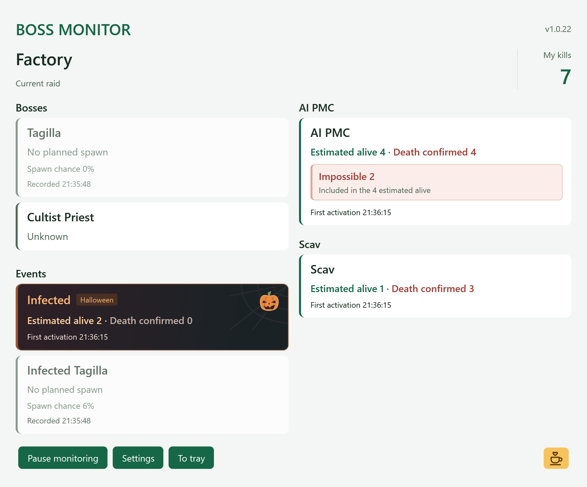

# Tarkov Boss Monitor

[한국어](README.ko.md) · **English** · [简体中文](README.zh-CN.md)

A Windows x64 app that detects boss spawns in official PvE raids running locally on your PC.

## When it is useful

- **Interchange Killa runs**: Check whether Killa is planned to spawn and actually activates. Once confirmed, use his initial zone to narrow your search.
- **Night Factory Cultist runs**: Avoid repeatedly searching the entire map in raids where the Cultist Priest did not spawn.

`Planned` means the game log selected the boss for spawning. `Confirmed` means an actual boss activation record was detected. Initial zones and coordinates are not current positions.

## Features

- Detects the current map from raid logs
- Shows activated, estimated-alive, and confirmed-dead Rogue and Raider counts
- Tracks infected and infected Tagilla separately in the Events section, including infected Tagilla's spawn chance, spawn decision, and life state after activation
- Lets you choose bosses to monitor for each map
- Shows combined estimated-alive and confirmed-dead counts for BEAR and USEC in one AI PMC card
- Highlights the difficulty and count of estimated surviving Impossible PMCs, explicitly included in the total estimated survivors
- Continuously estimates the Woods BTR's current stop and travel segment from log signals
- Supports installation while the game is running
- Cleans old game logs safely with a Windows scheduled task

## Download

[Download the latest release](https://github.com/seongjin-lab/tarkov-boss/releases/latest)

The installer is not code-signed, so Windows SmartScreen may display a warning.

## Screenshot



## Launcher repair warning

To obtain detailed AI spawn logs, Tarkov Boss Monitor changes the `aiData` log level in `Logging.config`. BSG Launcher may therefore identify this file as modified and display a **game repair required** warning.

If the warning appears, let the launcher finish repairing the game, exit the game completely, reopen Tarkov Boss Monitor and reapply the logging settings, and then restart the game. Repeat these steps whenever a game update or integrity check restores `Logging.config` to the original version.

## Uninstall

Exit Escape from Tarkov completely, then select **Uninstall Tarkov Boss Monitor** from the Start menu or remove Tarkov Boss Monitor from **Windows Settings → Apps → Installed apps**.

The uninstaller removes the log-cleanup scheduled task and automatically restores the `Logging.config` log levels changed by this app to their pre-installation values. If the game is running or the logging configuration has changed since installation, automatic restoration is skipped for safety and the uninstall result shows the backup location.

## Support

- Supported: official PvE raids that run locally and produce detailed AI logs
- Not supported: PvP, online PvE, and maps that do not support local play
- Maps such as Streets of Tarkov, which cannot be played locally, are not supported
- Boss positions and survival states are not guaranteed. The Woods BTR location is an estimate based on departure-ready signals and route timing

## Build

Requirements: Windows 10 or later, .NET 8 SDK, and Inno Setup 6.

```powershell
.\build.ps1
```

The installer is created in `outputs/installer`.

Run `.\test.ps1` to execute the regression tests without installing the game. See the [testing guide](tests/README.md) for fixture details and instructions for checking archived original logs.

## Contributing

Before opening a PR, read the [contribution guide and coding conventions](CONTRIBUTING.md) (Korean). Instructions for coding agents are in [AGENTS.md](AGENTS.md) and [CLAUDE.md](CLAUDE.md).

## Buy the developer a coffee

[Buy the developer a coffee](https://buymeacoffee.com/wjdtjdwls9p)

## License

This project is licensed under the [MIT License](LICENSE).

This is an unofficial tool and is not affiliated with Battlestate Games or Escape from Tarkov.
