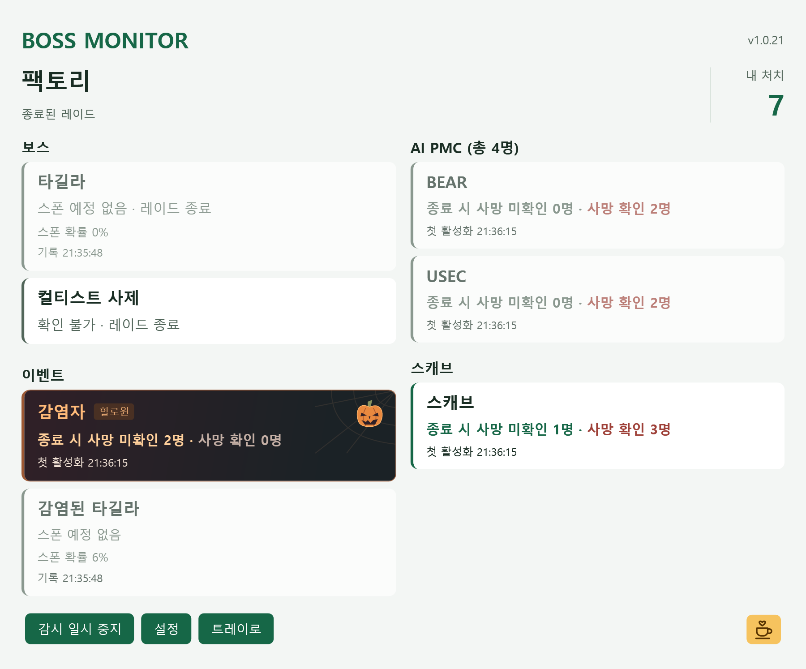

# Tarkov Boss Monitor

**한국어** · [English](README.en.md) · [简体中文](README.zh-CN.md)

타르코프 공식 PvE를 로컬로 실행한 레이드에서 보스 출현을 확인하는 Windows x64 앱입니다.

## 이런 상황에 유용합니다

- **인터체인지 킬라런**: 킬라의 스폰 예정 여부와 실제 활성화를 확인하고, 스폰이 확인되면 최초 구역을 참고해 탐색 범위를 줄일 수 있습니다.
- **야간 공장 컬티스트런**: 컬티스트 사제가 없는 레이드에서 맵 전체를 반복해서 수색하는 시간을 아낄 수 있습니다.

`스폰 예정`은 게임 로그의 생성 판정을 뜻하며, `스폰 확인`은 보스의 실제 활성화 기록이 감지되었다는 뜻입니다. 최초 구역과 좌표는 현재 위치가 아닙니다.

## 주요 기능

- 레이드 로그에서 현재 맵 자동 감지
- 로그(Rogue)와 레이더(Raider)의 활성화 수, 생존 추정 수, 사망 확인 수 표시
- 이벤트 영역에서 감염자와 감염된 타길라를 별도로 표시하며, 감염된 타길라의 스폰 확률·판정 및 실제 등장 후 생존·사망 상태 추적
- 맵별 감시 보스 선택
- AI PMC 카드 하나에 BEAR·USEC의 생존 추정 인원과 사망 확인 인원을 합산해 표시
- 생존 추정 Impossible PMC의 난이도·인원수를 강조하고, 전체 생존 추정 수에 포함된 인원임을 표시
- 우드 BTR의 현재 정류장과 이동 구간을 로그 기반으로 계속 추정 표시
- 게임 실행 중 설치 지원
- Windows 예약 작업으로 오래된 게임 로그 안전하게 정리

## 다운로드

[최신 버전 설치 파일 받기](https://github.com/seongjin-lab/tarkov-boss/releases/latest)

설치 파일은 코드 서명되지 않아 Windows SmartScreen 경고가 표시될 수 있습니다.

## 화면



## 런처 복구 경고

상세 AI 스폰 로그를 받기 위해 `Logging.config`의 `aiData` 로그 수준을 변경하므로, BSG Launcher가 이 파일을 변조된 파일로 판단해 **게임 파일 복구 필요** 경고를 표시할 수 있습니다.

경고가 나타나면 런처에서 복구를 완료한 뒤 게임을 완전히 종료하고 Tarkov Boss Monitor를 다시 실행해 로그 설정을 재적용한 다음 게임을 다시 시작하세요. 게임 업데이트나 파일 무결성 검사로 `Logging.config`가 원본으로 복구된 경우에도 같은 절차가 필요합니다.

## 제거

타르코프를 완전히 종료한 뒤 시작 메뉴의 **Tarkov Boss Monitor 제거**를 실행하거나, Windows **설정 → 앱 → 설치된 앱**에서 Tarkov Boss Monitor를 제거합니다.

제거 프로그램은 로그 정리 예약 작업을 삭제하고, 이 프로그램이 변경한 `Logging.config`의 로그 수준을 설치 전 값으로 자동 복원합니다. 게임이 실행 중이거나 설치 후 로그 설정이 변경된 경우에는 안전을 위해 자동 복원하지 않으며, 제거 결과에 백업 위치를 안내합니다.

## 지원 범위

- 지원: 로컬로 실행되며 상세 AI 로그를 기록하는 공식 PvE 레이드
- 미지원: PvP, 온라인 PvE, 로컬 실행을 지원하지 않는 맵
- Streets of Tarkov(스오타)처럼 로컬 플레이가 불가능한 맵은 지원하지 않습니다.
- 보스 현재 위치와 생존 여부 판정은 보장하지 않습니다. 우드 BTR 위치는 출발 준비 신호와 노선 시간에 따른 추정값입니다.

## 직접 빌드

Windows 10 이상, .NET 8 SDK, Inno Setup 6가 필요합니다.

```powershell
.\build.ps1
```

설치 파일은 `outputs/installer`에 생성됩니다.

회귀 테스트는 `.\test.ps1`로 실행합니다. 게임 설치 없이 사용할 수 있으며, 데이터 구성과 원본 로그 검증 방법은 [테스트 안내](tests/README.md)를 참고하세요.

## 기여하기

PR을 보내기 전에 [기여 가이드와 코딩 컨벤션](CONTRIBUTING.md)을 확인해 주세요. AI 도구용 지침은 [AGENTS.md](AGENTS.md)와 [CLAUDE.md](CLAUDE.md)에 있습니다.

## 라이선스

이 프로젝트는 [MIT 라이선스](LICENSE)를 따릅니다.

Battlestate Games 및 Escape from Tarkov와 관련 없는 비공식 도구입니다.
